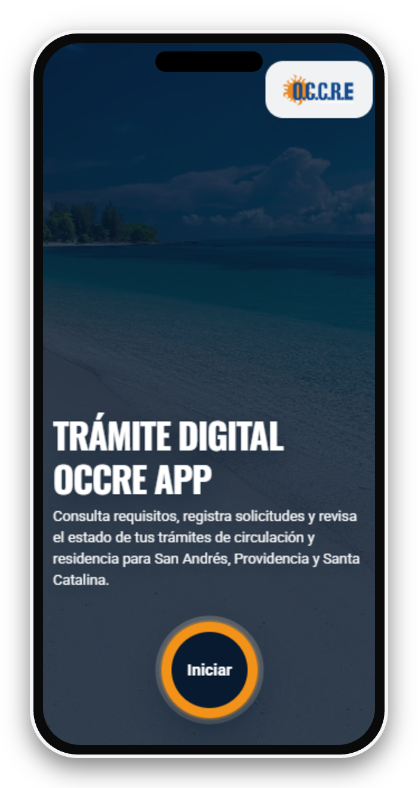
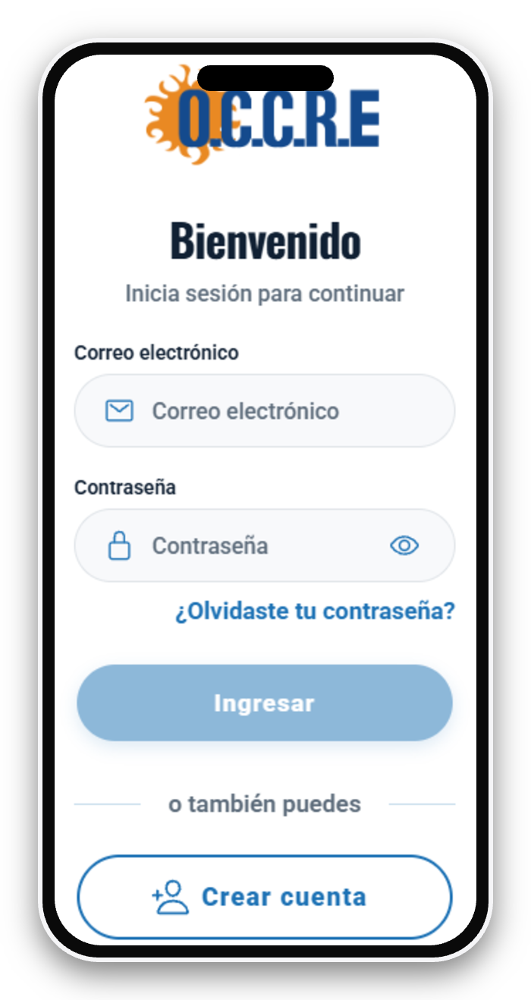
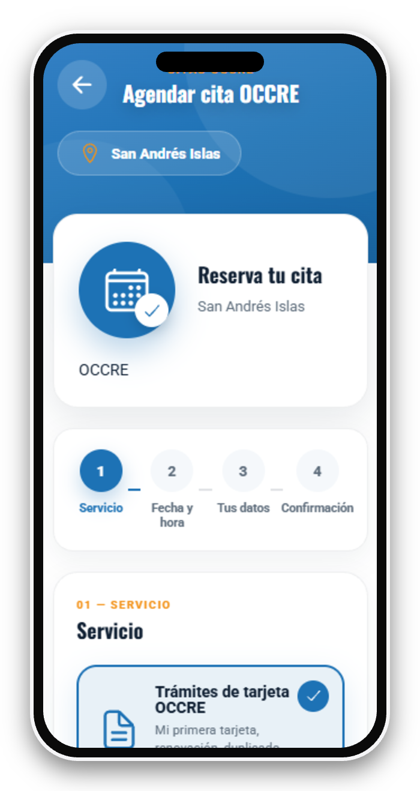

# OCCRE — Oficina de Control, Circulación y Residencia

<!-- markdownlint-disable MD033 -->
<p align="center">
  
</p>

<div align="center">
  
  
  
  
</div>
<!-- markdownlint-enable MD033 -->

Aplicación móvil oficial de la **Oficina de Control, Circulación y Residencia (OCCRE)** de San Andrés Islas, Colombia. Incluye el frontend móvil (Ionic + Angular + Capacitor) y el backend de API (Laravel).

## Tecnologias

### Frontend movil (Ionic + Angular)

[](https://angular.dev)
[](https://ionicframework.com)
[](https://www.typescriptlang.org)
[](https://developer.mozilla.org/en-US/docs/Web/HTML)
[](https://developer.mozilla.org/en-US/docs/Web/CSS)
[](https://developer.mozilla.org/en-US/docs/Web/JavaScript)
[](https://sass-lang.com)
[](https://capacitorjs.com)

### Backend (Laravel API REST)

[](https://laravel.com)
[](https://www.php.net)
[](https://www.mysql.com)
[](https://getcomposer.org)
[](https://jwt.io)
[](https://swagger.io)
[](https://firebase.google.com)
[](https://laravel-excel.com)

### Herramientas

[](https://git-scm.com)
[](https://github.com/features/actions)
[](https://www.hostinger.com)

---

## Stack tecnologico

| Capa                | Tecnologia                                                         | Version              |
| ------------------- | ------------------------------------------------------------------ | -------------------- |
| **Frontend**        | Ionic + Angular                                                    | Ionic 8 / Angular 20 |
| **Backend**         | Laravel (API REST)                                                 | Laravel 12 / PHP 8.2 |
| **Base de datos**   | MySQL                                                              | 8+                   |
| **Autenticacion**   | JWT (`tymon/jwt-auth`) + bcrypt (PHP)                              | -                    |
| **Traducciones**    | Sistema i18n propio (`TranslatePipe` + `TranslationService`)       | 6 idiomas            |
| **Plugins moviles** | Capacitor (Biometric, Push, LocalNotifications, Geolocation, etc.) | Capacitor 8          |
| **Plataformas**     | Android + iOS (Capacitor)                                          | -                    |
| **Despliegue**      | FTP a Hostinger (`deploy-ftp.ps1`) + CI en GitHub Actions          | -                    |

---

## Estructura del proyecto

```text
sgcm-app/
  src/                              # Frontend Ionic/Angular
    app/
      core/
        services/                   # Tourism-card, appointments, procedures
        strategies/                 # SelectivePreloadStrategy
      features/                     # Modulos lazy-load
        auth/                       #   login, register, recover-password
        home/                       #   Inicio
        welcome/                    #   Pantalla de bienvenida
        procedures/                 #   Tipos de tramite + detalle
        my-procedures/              #   Mis tramites
        procedure-detail/           #   Detalle de un tramite
        requests/                   #   Radicados: crear, seguimiento, detalle
        record-search/              #   Consulta de radicados por numero
        appointments/               #   Citas presenciales
        announcements/              #   Avisos (lista + detalle)
        notifications/              #   Notificaciones
        profile/                    #   Perfil del ciudadano
        settings/                   #   Configuracion (idioma, servidor, tema)
        help-contact/               #   Ayuda y contacto
        legal/                      #   Legal
        data-protection/            #   Proteccion de datos
        tourism-card/               #   Tarjeta de turismo (5 paginas publicas)
        admin/                      #   Panel administrativo (dashboard, citas,
                                    #   radicados, documentos, reportes, audit,
                                    #   population-map (SIG poblacional), etc.)
      guards/                       # auth.guard, admin.guard
      interceptors/                 # auth, cache, error, network, timeout
      services/                     # Servicios globales (auth, translation, chat, etc.)
      pipes/                        # translate.pipe (i18n)
      shared/                       # bottom-menu, occre-chatbot, stat-card
    environments/                   # environment.ts, .lan, .tunnel, .prod
    theme/                          # Variables SCSS globales
  backend/                  # Backend Laravel (API REST)
    app/
      Console/Commands/             # SendReturnReminders (tarea programada)
      Exports/                      # RequestsReportExport (Excel)
      Http/Controllers/Api/         # 17 controladores (auth, citas, radicados, etc.)
      Http/Middleware/              # RoleMiddleware, VerifyPaymentSignature
      Jobs/                         # SendMailJob, SendReturnReminderJob, SendUserNotificationJob
      Models/                       # Modelos Eloquent (23)
      Services/                     # Gemini, PaymentProvider, PushService, QrCodeService
    routes/api.php                  # Contrato de la API
    database/migrations/            # Migraciones de la BD
    database/seeders/               # Datos semilla
    DEPLOYMENT.md                   # Guia de despliegue en hosting
  android/                  # Proyecto Android (Capacitor)
  ios/                      # Proyecto iOS (Capacitor)
  assets/                   # Iconos y splash fuente para @capacitor/assets
  .github/workflows/        # CI: build + deploy por FTP
  deploy-ftp.ps1            # Script de despliegue por FTP
  angular.json / capacitor.config.ts / ionic.config.json
```

---

## Comandos principales

### Frontend + backend (un solo comando)

```bash
npm run dev            # frontend (localhost:8100) + backend Laravel (127.0.0.1:8000)
npm run dev:tunnel     # frontend con API del tunel + backend local
```

### Backend (Laravel)

```powershell
cd backend
composer install                          # solo la primera vez
# Crear la base de datos (XAMPP local; usuario root sin contrasena)
& "C:\xampp\mysql\bin\mysql.exe" -u root -e "CREATE DATABASE IF NOT EXISTS sgcm_db CHARACTER SET utf8mb4 COLLATE utf8mb4_unicode_ci;"
php artisan migrate:fresh --seed          # tablas + datos semilla (BD sgcm_db)
php artisan serve --host=127.0.0.1 --port=8000
```

### Frontend (Ionic/Angular)

```bash
npm start                    # ng serve -> http://localhost:8100
npm run start:tunnel         # ng serve con API del tunel

npm run build                # genera www/ (API -> /api por proxy en dev / prod)
npm run build:tunnel         # API -> tunel Cloudflare
npm run build:lan            # API -> IP de red local

npm run lint                 # ESLint sobre src/**/*.ts y *.html

# Capacitor (Android/iOS)
ionic cap sync
ionic cap open android
ionic cap open ios
```

### Despliegue a hosting (FTP)

```bash
npm run deploy          # build + sube solo cambios (deploy-ftp.ps1)
npm run deploy:full     # build + sube todo (frontend + backend)
```

---

## Requisitos del entorno

| Herramienta     | Version                         | Uso                            |
| --------------- | ------------------------------- | ------------------------------ |
| Node.js         | 20+                             | Frontend                       |
| npm             | 10+                             | Gestor de paquetes             |
| PHP             | 8.2+                            | Backend Laravel                |
| Composer        | 2+                              | Dependencias PHP               |
| MySQL / MariaDB | 8+ / 10.4+                      | Base de datos (localhost:3306) |
| JDK (Temurin)   | 21                              | Solo para compilar APK         |
| Android SDK     | platform 36 + build-tools 35/36 | Solo para compilar APK         |

---

## Configuracion del entorno

### Backend (`backend/.env`)

| Variable                 | Descripcion                                           | Default                 |
| ------------------------ | ----------------------------------------------------- | ----------------------- |
| `APP_URL`                | URL del backend                                       | `http://localhost:8000` |
| `DB_DATABASE`            | Nombre de la BD                                       | `sgcm_db`               |
| `DB_USERNAME`            | Usuario MySQL                                         | `root`                  |
| `DB_PASSWORD`            | Contrasena MySQL                                      | -                       |
| `JWT_SECRET`             | Secreto para firmar tokens (`php artisan jwt:secret`) | -                       |
| `JWT_TTL`                | Vigencia del token (minutos)                          | `10080`                 |
| `FRONTEND_URL`           | Origen CORS permitido                                 | `http://localhost:8100` |
| `GEMINI_API_KEY`         | API key de Google Gemini (chatbot IA)                 | -                       |
| `GEMINI_MODEL`           | Modelo Gemini a usar                                  | `gemini-2.5-flash`      |
| `PAYMENT_GATEWAY_URL`    | URL de pasarela de pago                               | -                       |
| `PAYMENT_WEBHOOK_SECRET` | Secreto para firmar el webhook de pagos               | -                       |
| `FIREBASE_CREDENTIALS`   | Credenciales de Firebase Cloud Messaging              | -                       |

### Frontend (`src/environments/environment*.ts`)

| Archivo                 | Uso                          | URL del API                                                 |
| ----------------------- | ---------------------------- | ----------------------------------------------------------- |
| `environment.ts`        | `npm start` (dev)            | `/api` (proxy -> 127.0.0.1:8000)                            |
| `environment.lan.ts`    | `npm run build:lan`          | `http://<ip-lan>:8000/api`                                  |
| `environment.tunnel.ts` | `npm run dev:tunnel`         | `https://*.trycloudflare.com/api`                           |
| `environment.prod.ts`   | `npm run build` (produccion) | `https://lightslategray-loris-726565.hostingersite.com/api` |

---

## Credenciales de acceso (usuarios semilla)

Se crean con `php artisan db:seed` (o `migrate:fresh --seed`). Email y contrasena son configurables con las variables `SEED_*` en `backend/.env`.

| Rol                     | Email                  | Contrasena | Acceso                    |
| ----------------------- | ---------------------- | ---------- | ------------------------- |
| **Usuario (prueba)**    | `owen@sgcm.app`        | `1234567`  | Solo app `/login` (rol ciudadano) |
| **Funcionario (prueba)**| `funcionario@sgcm.app` | `1234567`  | Panel `/admin/login` (rol funcionario) |

> **Separación de roles**: un usuario con rol `ciudadano` (ej. `owen@sgcm.app`) **NO** entra al panel `/admin/*`. El login del panel rechaza cuentas sin rol `funcionario`/`admin`, el `AdminGuard` redirige a `/home` y el backend responde `403`. El funcionario puede listar usuarios y cambiar sus roles; eliminar usuarios y la auditoría son exclusivos de `admin`. Los roles de los seed se aplican con `sync()` (el seed corrige roles sobrantes de versiones previas).

---

## API Endpoints

Base: `/api`.

### Autenticacion y usuarios

| Ruta                         | Metodos  | Auth      | Descripcion            |
| ---------------------------- | -------- | --------- | ---------------------- |
| `/auth/register`             | POST     | -         | Registro de ciudadano  |
| `/auth/login`                | POST     | -         | Inicio de sesion       |
| `/auth/forgot-password`      | POST     | -         | Solicitar recuperacion |
| `/auth/reset-password`       | POST     | -         | Restablecer contrasena |
| `/auth/profile`              | GET, PUT | JWT       | Perfil del usuario     |
| `/auth/photo`                | PUT      | JWT       | Subir foto de perfil   |
| `/auth/change-password`      | PUT      | JWT       | Cambiar contrasena     |
| `/auth/change-email`         | PUT      | JWT       | Cambiar email          |
| `/auth/users`                | GET      | JWT+admin | Listar usuarios        |
| `/auth/users/{userId}/roles` | PUT      | JWT+admin | Actualizar roles       |
| `/auth/biometric-preference` | GET, PUT | JWT       | Preferencia biometrica |

### Tramites, radicados y documentos

| Ruta                                      | Metodos                | Auth                     | Descripcion              |
| ----------------------------------------- | ---------------------- | ------------------------ | ------------------------ |
| `/procedures`                             | GET, POST, PUT, DELETE | GET publico; resto admin | Tipos de tramite         |
| `/requests/search-record`                 | POST                   | -                        | Consulta por numero      |
| `/requests`                               | POST                   | JWT                      | Crear radicado           |
| `/requests/my`                            | GET                    | JWT                      | Mis radicados            |
| `/requests/my-procedures`                 | GET                    | JWT                      | Mis tramites             |
| `/requests/tracking/{id}`                 | GET                    | JWT                      | Seguimiento por numero   |
| `/requests/assigned`                      | GET                    | JWT+funcionario          | Radicados asignados      |
| `/requests/all`                           | GET                    | JWT+funcionario          | Todos los radicados      |
| `/requests/{id}/status`                   | PATCH                  | JWT+funcionario          | Actualizar estado        |
| `/requests/{id}/assign`                   | PATCH                  | JWT+admin                | Asignar funcionario      |
| `/documents/upload`                       | POST                   | JWT                      | Subir documento          |
| `/documents/{id}/download`                | GET                    | JWT                      | Descargar documento      |
| `/documents/{id}/validate`                | PATCH                  | JWT+funcionario          | Validar documento        |
| `/documents/{id}`                         | DELETE                 | JWT                      | Eliminar documento       |
| `/certificates/generate/{trackingNumber}` | GET                    | JWT                      | Constancia en PDF + QR   |
| `/certificates/validate-qr`               | POST                   | -                        | Validar QR de constancia |

### Citas

| Ruta                         | Metodos | Auth      | Descripcion           |
| ---------------------------- | ------- | --------- | --------------------- |
| `/appointments/services`     | GET     | -         | Servicios disponibles |
| `/appointments/offices`      | GET     | -         | Oficinas              |
| `/appointments/availability` | GET     | -         | Disponibilidad        |
| `/appointments`              | POST    | JWT       | Crear cita            |
| `/appointments/my`           | GET     | JWT       | Mis citas             |
| `/appointments/all`          | GET     | JWT+staff | Todas las citas       |
| `/appointments/{id}/cancel`  | PATCH   | JWT       | Cancelar cita         |
| `/appointments/{code}`       | GET     | JWT       | Consultar por codigo  |

### Notificaciones, dispositivos y avisos

| Ruta                          | Metodos   | Auth      | Descripcion            |
| ----------------------------- | --------- | --------- | ---------------------- |
| `/notifications`              | GET       | JWT       | Notificaciones         |
| `/notifications/unread-count` | GET       | JWT       | Contador no leidas     |
| `/notifications/read-all`     | PATCH     | JWT       | Marcar todas leidas    |
| `/notifications/{id}/read`    | PATCH     | JWT       | Marcar como leida      |
| `/notifications/clear-all`    | DELETE    | JWT       | Limpiar notificaciones |
| `/devices/register`           | POST      | JWT       | Registrar token push   |
| `/devices/unregister`         | POST      | JWT       | Quitar token           |
| `/devices/my`                 | GET       | JWT       | Mis dispositivos       |
| `/announcements/active`       | GET       | -         | Avisos activos         |
| `/announcements`              | GET, POST | JWT+admin | Administrar avisos     |

### Panel administrativo (API)

| Ruta                     | Metodos | Auth                  | Descripcion                |
| ------------------------ | ------- | --------------------- | -------------------------- |
| `/admin/dashboard`       | GET     | JWT+admin/funcionario | Estadisticas               |
| `/admin/reports`         | GET     | JWT+admin/funcionario | Reportes                   |
| `/admin/export/excel`    | GET     | JWT+admin/funcionario | Exportar Excel             |
| `/admin/export/pdf`      | GET     | JWT+admin/funcionario | Exportar PDF               |
| `/admin/funcionarios`    | GET     | JWT+admin/funcionario | Lista de funcionarios      |
| `/admin/population-map`  | GET     | JWT+admin/funcionario | Zonas de población raizal  |
| `/admin/documents`       | GET     | JWT+admin/funcionario | Documentos                 |
| `/admin/documents/stats` | GET     | JWT+admin/funcionario | Estadisticas de documentos |
| `/admin/audit-log`       | GET     | JWT+admin             | Bitacora de auditoria      |

### Tarjeta de turismo (publico)

| Ruta                                       | Metodo | Descripcion                         |
| ------------------------------------------ | ------ | ----------------------------------- |
| `/tourism-card/tariff`                     | GET    | Tarifa activa                       |
| `/tourism-card/quote`                      | POST   | Cotizar monto                       |
| `/tourism-card/card`                       | POST   | Crear solicitud de tarjeta          |
| `/tourism-card/card/{code}/payment/init`   | POST   | Inicializar pago                    |
| `/tourism-card/card/{code}/payment/status` | GET    | Estado del pago                     |
| `/tourism-card/card/{code}/receipt`        | GET    | Datos del recibo                    |
| `/tourism-card/card/{code}/verify`         | GET    | Validar tarjeta por codigo          |
| `/tourism-card/card/verify/qr/{qr_token}`  | GET    | Validar tarjeta por token QR        |
| `/tourism-card/card/{code}/share-location` | POST   | Compartir ubicacion voluntaria      |
| `/tourism-card/search`                     | POST   | Buscar tarjeta (codigo + documento) |
| `/tourism-card/payment/webhook`            | POST   | Webhook de pasarela (firma HMAC)    |
| `/tourism-card/expired/check`              | POST   | Marcar tarjetas vencidas            |

### Chatbot y salud

| Ruta      | Metodo | Auth | Descripcion                                |
| --------- | ------ | ---- | ------------------------------------------ |
| `/chat`   | POST   | JWT  | Respuesta del asistente IA (Google Gemini) |
| `/health` | GET    | -    | Health check del servidor                  |

---

## Chatbot con IA (Miss Lorna)

1. **Respuestas locales rapidas**: coincidencia por palabras clave con el FAQ de OCCRE (funciona sin internet).
2. **IA generativa (Google Gemini)**: si no coincide con el FAQ, consulta a Gemini y responde en el idioma del usuario.

Sin `GEMINI_API_KEY` el endpoint `/chat` responde `503` y el chatbot usa solo el FAQ local.

---

## Panel administrativo

Acceso en `/admin/*` con credenciales de funcionario/admin (protegido por `AdminGuard` y roles `admin`/`funcionario` en el backend).

### Dashboard (`/admin/dashboard`)

- **KPIs**: solicitudes activas, documentos pendientes, citas agendadas y usuarios registrados con tarjetas clicables que navegan a su seccion (`app-stat-card`).
- **Graficas (Chart.js)**: documentos por estado (dona), documentos cargados por mes (barras apiladas), solicitudes por estado (dona), usuarios registrados por mes (barras), citas por dia (linea), solicitudes por mes (linea) y tramites mas solicitados (barras horizontales). Los colores se adaptan al tema claro/oscuro via variables CSS.
- **Filtros de rango**: desde/hasta por fecha y por estado de solicitud; aplican a estadisticas y exportaciones.
- **Exportacion**: botones Excel (`/admin/export/excel`) y PDF (`/admin/export/pdf`) que descargan el reporte filtrado via `HttpClient` con `responseType: 'blob'`.
- **Botonera nativa (ventanilla)** con capacidad de degradado en web:
  - **QR** -> escaneo de identidad con `@capacitor-mlkit/barcode-scanning`.
  - **GPS** -> captura de coordenadas de visita/censo con `@capacitor/geolocation`.
  - **Compartir** -> hoja nativa de compartir constancia con `@capacitor/share`.
  - **Actualizar** -> recarga las estadisticas (spinner girando mientras carga).
- **Tablas**: ultimas solicitudes (radicado, tramite, ciudadano, estado, prioridad) y actividad reciente (creaciones, documentos, citas).
- **Chatbot OCCRE (Gemini)** como componente flotante, disponible tambien en el dashboard para orientar al funcionario.

### Mapa de población (`/admin/population-map`)

- **Mapa SIG interactivo** de San Andrés con **Leaflet** (cargado perezosamente con `import('leaflet')` + tiles de OpenStreetMap).
- Cada **zona/sector** se representa con un `CircleMarker` cuyo **tamaño refleja la población total** y el **color la proporción raizal**.
- **Totales**: habitantes, raizales, otros residentes y número de sectores (chips superiores).
- **Filtros**: todos los sectores, mayoría raizal (≥ 50%) y mayor población.
- **Sidebar de detalle**: al hacer clic en un punto o en la lista, muestra población total, raizales, otros, porcentaje raizal (barra) y descripción; `flyTo` al punto seleccionado.
- **Leyenda de proporción raizal** (< 25%, 25–40%, 40–60%, > 60%).
- **Datos**: `GET /admin/population-map` (modelo `PopulationZone` en el backend).

---

## Internacionalizacion (i18n)

- **6 idiomas**: espanol (`es`), ingles (`en`), frances (`fr`), portugues (`pt`), italiano (`it`), chino mandarin (`zh`).
- **Idioma por defecto**: `es`. Persistencia en `localStorage` (`occre_lang`).
- **Mecanismo**: `TranslationService` + `TranslatePipe` (impuro), sin dependencias externas.
- **Selectores**: settings (solo `es`/`en`) y paginas de turismo (los 6 idiomas).

---

## Tarjeta de turismo - flujo

1. **Formulario multi-paso** (`/tarjeta-turismo`): personal -> viaje -> hospedaje -> confirmacion -> exito.
2. **Pago** (`/tarjeta-turismo/pago/:code`): grid 2x2 (Bancolombia, Nequi, Tarjeta, PSE).
3. **Recibo** (`/tarjeta-turismo/recibo/:code`): comprobante + recordatorios + ubicacion voluntaria.
4. **Consultar** (`/consultar-tarjeta-turismo`): buscar por codigo + documento.
5. **Validar** (`/validar-tarjeta-turismo/:code` o `/validar-tarjeta-turismo/qr/:qr_token`).

Caracteristicas del backend: codigo unico `SGCM-TT-{ano}-{6 digitos}`, recibo `RC-{ano}-{6 digitos}` generado en el webhook, token QR UUID v4, maquina de estados `Pendiente -> Pagado -> Vencida`, recordatorios de retorno (email/SMS/push) y tarea programada que vence tarjetas automaticamente.

---

## Generar APK (sin Android Studio)

```bash
npm run build
npx cap sync android
cd android
.\gradlew.bat assembleDebug
# Resultado: android\app\build\outputs\apk\debug\app-debug.apk
```

Requisitos previos: `ANDROID_HOME` y `JAVA_HOME` apuntando al Android SDK y JDK 21. El APK debug usa el keystore de debug (instalable en cualquier dispositivo). Para Play Store se requiere `assembleRelease` con un keystore propio.

### APK de prueba (release)

El APK de prueba firmado más reciente está disponible en:

```
apk/my-occre-app.apk
```

Se regenera con:

```bash
npm run build
npx cap sync android
cd android
.\gradlew.bat assembleRelease
# Copiar el resultado a apk/:
Copy-Item app\build\outputs\apk\release\app-release.apk ..\apk\my-occre-app.apk
```

Es instalable en cualquier dispositivo Android (permite instalar desde fuentes desconocidas) y usa el keystore `occre-release.jks`.

Los iconos y la splash se generan desde `assets/` con `npx capacitor-assets generate --android`.

---

## Extensiones recomendadas de VSCode

Definidas en `.vscode/extensions.json` (se ofrecen al abrir el proyecto): Angular Language Service, ESLint, Prettier, EditorConfig, GitLens, MySQL Client 2, Path Intellisense, TypeScript Nightly e Ionic.

---

## Referencias

- `backend/DEPLOYMENT.md`: guia detallada de despliegue del backend en hosting compartido (cPanel).
- `deploy-ftp.ps1`: script de despliegue frontend + backend por FTP.
- `.github/workflows/deploy.yml`: CI que compila y despliega el frontend al hacer push a `main`.
